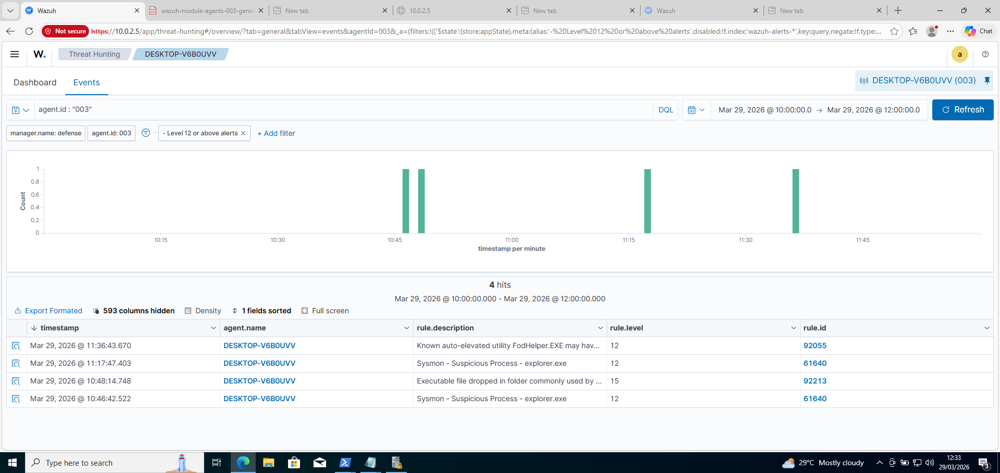
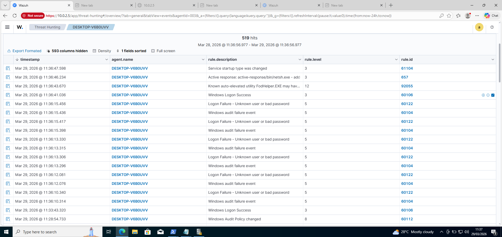
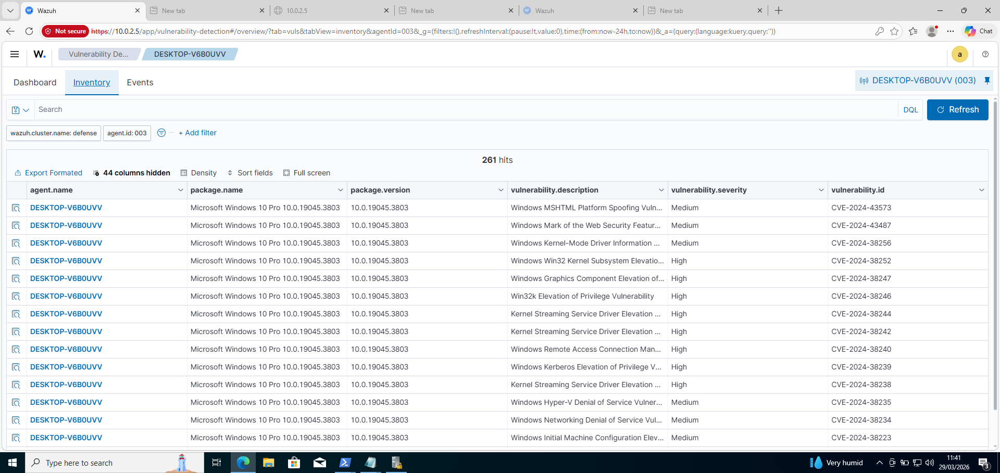
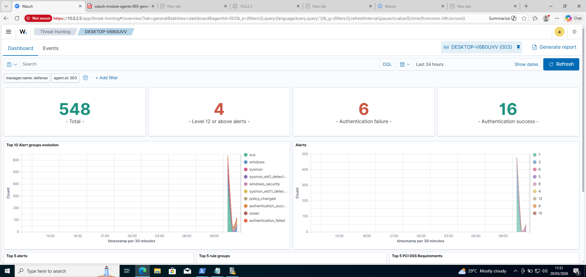
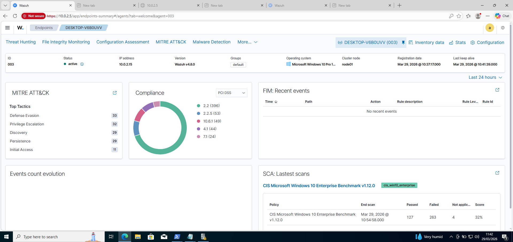

# 🚀 Advanced Endpoint Protection Lab: Malware & Zero-Trust Defense

## 🛡️ Project Focus
This documentation covers the second phase of my SOC engineering progression. While the prior lab focused on initial SIEM architecture, this project is dedicated to **Advanced Endpoint Defense**. I engineered a custom telemetry pipeline designed specifically to catch high-severity threats that evade standard Windows Defender and Microsoft audit logging.

**Core Achievements:**
- Engineered **Level 15 Malware Detection** (Unauthorized executable drops).
- Designed logic to catch **Level 12 UAC Bypasses** (`FodHelper.exe`).
- Implemented **Autonomous SOAR Capabilities** using custom API-driven firewalls.

## ⚙️ Technical Architecture (New Environment)
- **Host System**: Windows 10 Pro (Monitored Endpoint)
- **Advanced Telemetry**: Microsoft Sysmon (Custom XML Rule Implementation)
- **SIEM Manager**: Wazuh Server on Ubuntu
- **Attacker Node**: Kali Linux 

## 🔍 Threat Hunting & Detections

### 1. The UAC Bypass (FodHelper)
Standard audit logs often miss sophisticated process injection and UAC (User Account Control) bypass techniques. By integrating Sysmon Event ID 1 (Process Creation) with the Wazuh agent, I captured a live bypass attempt.
- **Detection Level:** 12
- **Rule Trigger:** 92055
- **Proof:** 

### 2. The Level 15 Malware Drop
Dropping a malicious binary into a system folder is a classic persistence technique. While troubleshooting the Active Response, the heavily configured Sysmon pipeline caught an executable being dropped into a protected directory.
- **Detection Level:** 15 (Critical)
- **Rule Trigger:** 92213
- **Proof:** 

## 🛡️ Autonomous Defense Validation
The final milestone was proving the system could react faster than a human. Using Wazuh's `execd` process and a custom JSON-driven script mapping, the SIEM automatically executed a `netsh` firewall command to permanently block the attacker origin IP.
- **Proof:** 

## 📊 The "Eyes on Glass" SOC Dashboard
This instance collected over 540 distinct security events, efficiently parsing them down to the 4 critical (Level 12+) alerts that required analyst attention.
- **Proof:** 
- **Agent Connectivity:** 

---
*Developed and executed by Opeyemi Benjamin.*
